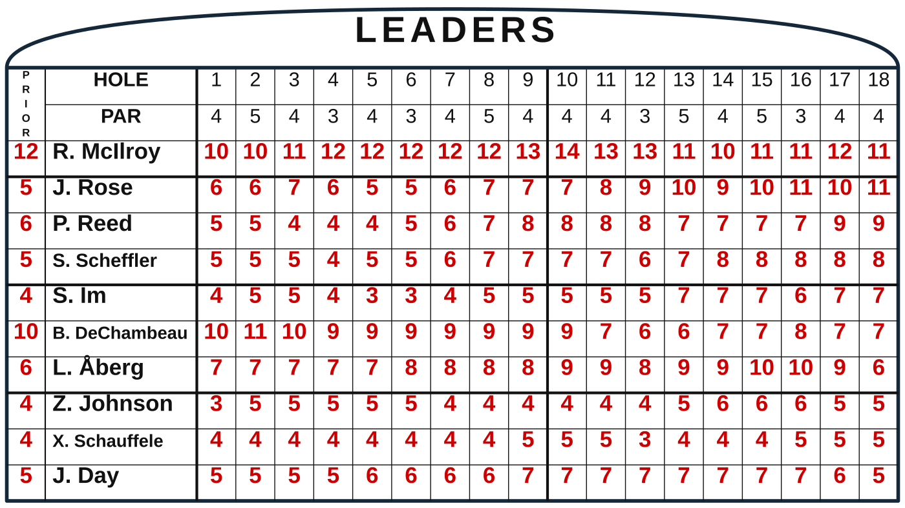
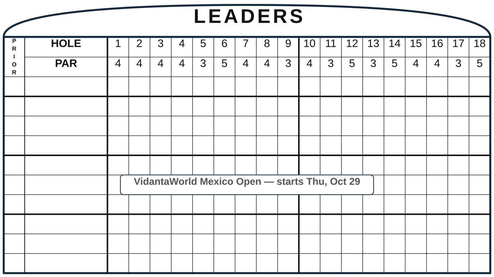

# Golf Leaderboard Card

[](https://github.com/hacs/integration)
[](https://github.com/AOPW-llc/golf-leaderboard-card/actions/workflows/validate.yml)

A Home Assistant dashboard card that draws a classic hand-operated tournament
scoreboard and fills it with live PGA Tour scoring. Each player's running score
is posted hole by hole, red under par and green at or over par, the way God intended.



## Features

- **Live top 10.** Refreshes automatically and shows each leader's running
  score through every hole of the current round, plus their score from prior
  rounds.
- **Real pars for every course.** The PAR row comes from the course actually
  being played, so it's right every week.
- **Custom view.** Pick any 10 players from the field with the dropdowns. Your
  picks are kept on that device.
- **Saved list.** Snapshot the live top 10 or your custom picks and come back
  to them later.
- **Any round.** Step back to Round 1, 2 or 3 to see the board as it stood then.
- **Any event this season.** Switch tournaments from the picker in the footer.
- **Scales to any width.** The board is drawn, not an image, so it stays sharp
  on a phone or a wall display.
- **No API key or integration needed.**

Before a tournament starts, the board shows that week's course pars and the
start date:



## Installation

### HACS (recommended)

1. In HACS, open the menu (⋮) → **Custom repositories**.
2. Add `https://github.com/AOPW-llc/golf-leaderboard-card` with category **Dashboard**.
3. Search for **Golf Leaderboard Card**, download it, and reload your browser.

### Manual

1. Download `golf-leaderboard-card.js` from the
   [latest release](https://github.com/AOPW-llc/golf-leaderboard-card/releases/latest).
2. Copy it to `/config/www/golf-leaderboard-card.js`.
3. Go to **Settings → Dashboards → ⋮ → Resources** and add
   `/local/golf-leaderboard-card.js` as a **JavaScript module**.

## Configuration

Add the card from the dashboard card picker (search "Golf"), or in YAML:

```yaml
type: custom:golf-leaderboard-card
```

| Option             | Default   | Description |
|--------------------|-----------|-------------|
| `title`            | `LEADERS` | Text in the arch at the top of the board. |
| `refresh_interval` | `5`       | Minutes between automatic refreshes. |
| `tournament_id`    | —         | Pin the card to one ESPN event ID (the number in an ESPN leaderboard URL). Leave empty to follow the current week's event. |
| `toggle_entity`    | —         | An `input_boolean` that mirrors the Live / Custom view, so you can switch views from automations or other cards. |

Example:

```yaml
type: custom:golf-leaderboard-card
title: LEADERS
refresh_interval: 2
```

## Using the card

| Control | What it does |
|---------|--------------|
| **Live** | Top 10 from the live leaderboard (cut players excluded). A gold ★ marks players who are also on your Custom board. |
| **Custom** | Pick a player for each row. Tap a name to change it. |
| **Save / Saved** | Save the current Live top 10 or Custom picks. Once saved, tap **Saved** to view that list. Edits there are kept only when you tap **Save** again. |
| **✕** | Clears the Custom board or the Saved list (whichever you're viewing). |
| **↻** | Refresh now. |
| Round label (e.g. *Round 3*, *Final*) | Tap to pick an earlier round. The board shows how it stood at the end of that round, ranked by score through that round. It opens on the round in progress, or *Final* once the tournament is over. |
| Event picker | Choose any event from this season's schedule. |

On the board, **C** in the prior column means the player missed the cut.

## Data sources

Scores come from ESPN's public scoreboard feed, and course pars from ESPN's
event feed. During the Masters the card also uses Masters.com's own scoring
feed when it's reachable. None of these are official, documented APIs, so a
change on their end can break the card until it's updated. If that happens,
please [open an issue](https://github.com/AOPW-llc/golf-leaderboard-card/issues).

This project isn't affiliated with or endorsed by the PGA Tour, ESPN, or any
tournament.

## License

[MIT](LICENSE)
